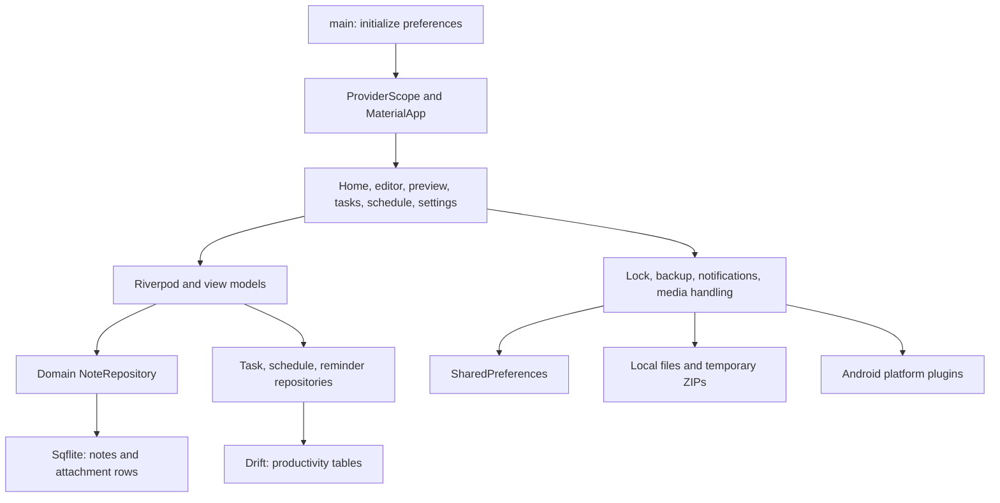
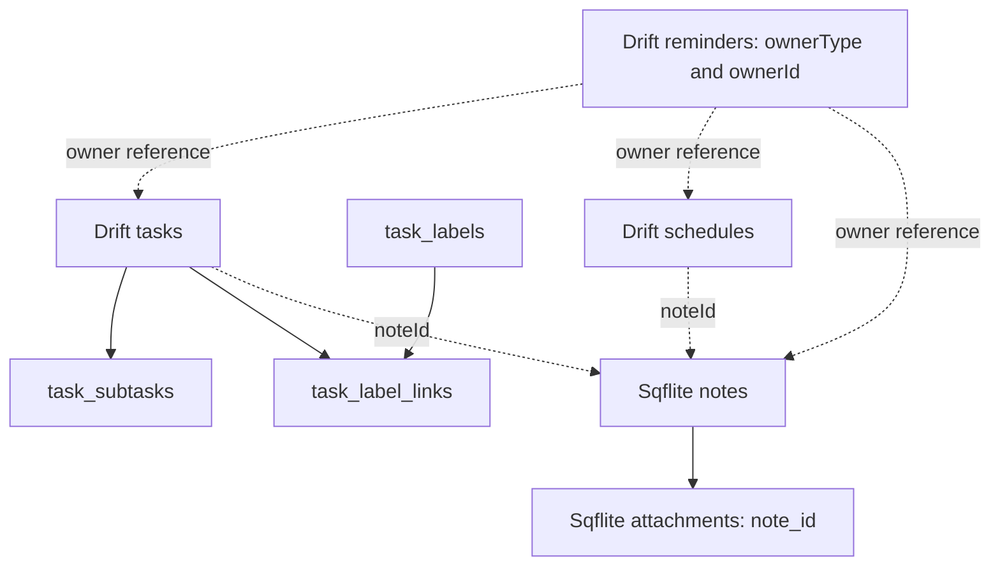

# Digital Memory — Application Architecture

> **As implemented · 19 October 2026.** Architecture conclusions are based on source, not folder names alone.

## 1. Assessment

The app uses a **partial MVVM/repository architecture**. The note repository has a domain contract and Riverpod supplies dependencies. Tasks, schedules, and reminders use concrete Drift repositories. Large screens still perform persistence, export, attachment, and navigation orchestration directly. This is a workable prototype structure, but the boundaries are inconsistent and make privacy and backup behavior difficult to enforce centrally.

## 2. Architecture diagram

[Open the editable tldraw architecture and workflow board](https://www.tldraw.com/f/MJ8ymcLzU-nKT2TWyaEVd).

The upper diagram shows dependencies; the lower diagram shows user flow. The dashed note-ID relationship represents an application-level reference, not a database foreign key.

## 3. Layer responsibilities

| Layer | Actual responsibility | Evidence | Assessment |
|---|---|---|---|
| Bootstrap | Load SharedPreferences and override DI provider | [`main.dart`](../lib/main.dart) | Explicit initialization is sound; tests must reproduce it |
| App shell | Themes, delegates, root navigator, notification host | [`app.dart`](../lib/app/app.dart) | Notification initialization is triggered from build and host lifecycle |
| Views | UI plus considerable business and file logic | [`home_screen.dart`](../lib/presentation/views/home/home_screen.dart), [`note_editor_screen.dart`](../lib/presentation/views/note_editor/note_editor_screen.dart) | Too many responsibilities concentrated in large files |
| View models | Loading, filters, persistence calls, reminder operations | [`view_models/`](../lib/presentation/view_models/) | Mixed state APIs; error handling inconsistent |
| Domain | Immutable note/attachment entities; note repository interface | [`domain/`](../lib/domain/) | Limited to notes; productivity domain exposes generated Drift types |
| Repositories | SQL mapping and persistence | [`data/repositories/`](../lib/data/repositories/) | Note change stream helps refresh; no unified transactional workflow |
| Platform services | Authentication, PIN, ZIPs, local notifications | [`core/services/`](../lib/core/services/) | Cross-cutting policies are not consistently enforced |

## 4. Startup and state

1. `main()` initializes Flutter and preferences.
2. `ProviderScope` overrides `sharedPreferencesProvider`; its default deliberately throws.
3. `App` watches settings and creates light/dark themes through `DynamicColorBuilder`.
4. `MaterialApp` starts `HomeScreen`, wrapped by `InAppReminderHost`.
5. Home initializes notes; tasks and schedule load as their providers/screens are used.
6. Foreground reminders use a periodic timer; lifecycle changes cancel or recreate system notifications.

**Risk:** `NotificationSyncService.init()` sets `_initialized = true` before asynchronous initialization finishes. Concurrent callers can observe a partly initialized service, and a failed initialization is not retried. Prefer one awaited initialization future with explicit failure recovery.

## 5. Persistence model

| Store | Filename / location | Contents | Main concern |
|---|---|---|---|
| Sqflite | Documents / `second_brain.db` | Notes, attachment metadata | Version 1 with no upgrade path yet |
| Drift | Documents / `second_brain_drift.db` | Tasks, schedules, reminders, subtasks, labels, links | Schema version 3; upgrade coverage needs verification |
| Preferences | Platform preferences | Theme, locale, font, lock settings, PIN, sort/filter state | PIN stored as an ordinary string |
| Media files | Picker/camera/recording paths | Actual attachment bytes | Some paths may be temporary; deletion leaves file lifecycle unclear |
| ZIP files | Temporary directory | Note JSON for backup; PDF/media for separate share flow | Different ZIP formats have different semantics |

### Relationships

Neither database enables SQLite foreign-key enforcement explicitly. Even enabled foreign keys could not enforce cross-file note references. Deleting a note does not coordinate linked tasks, schedules, and reminder ownership.

### Migration review

`AppDriftDatabase` creates all tables for fresh installs. Upgrades add task ordering for version 1 and `schedules.note_id` for versions below 3. Existing version 1/2 databases need explicit fixture tests proving that subtasks, labels, and link tables exist after upgrade. Fresh-install success would not prove upgrade safety.

## 6. Navigation

The live app uses `MaterialApp(home: HomeScreen())`, `Navigator`, `MaterialPageRoute`, tabs, and sheets. [`router.dart`](../lib/app/router.dart) defines a GoRouter which is not connected through `MaterialApp.router`. Two standalone drawer implementations coexist with a third private drawer inside Home. Some menu destinations show placeholder messages.

Recommendation: choose one active navigation system and remove or quarantine inactive variants after testing actual entry paths. A filename named `router.dart` does not establish deep-link support.

## 7. Security boundary

| Boundary | Current implementation | Required improvement |
|---|---|---|
| Locked preview | `NotePreviewScreen` authenticates unless `skipLockCheck` is true | Authentication policy shared by every entry path |
| Attachment browser | Enumerates all attachments; passes `skipLockCheck: note.isLocked` | Filter private assets and require authorization before preview/open/export |
| Reminder navigation | Some note routes pass `skipLockCheck: true` | Authenticate locked content on notification entry |
| PIN | Plain preferences string comparison | Secure verifier storage, numeric length validation, retry throttling |
| App lock | Biometric gate in Home lifecycle | Cover pushed screens, unavailable biometrics, and background snapshots |
| Vault session | In-memory unlocked boolean | Relock on lifecycle timeout; `relock()` currently has no caller |
| Storage | Ordinary SQLite and local files | Do not claim encrypted storage; define the intended threat model |

## 8. Maintainability and performance

- Home is roughly 3,000 lines; schedule roughly 2,100; note editor roughly 1,900. These combine state, rendering, persistence, gestures, and export concerns.
- The note repository batches attachment queries in chunks of 500, a useful safeguard against SQLite bind limits.
- Tasks load subtasks once per task sequentially; search fetches all tasks and filters in memory.
- Notes load the full collection. Paging and indexed search should follow measurement with realistic datasets.
- Some export paths read files synchronously on the UI isolate; large attachments could block frames.
- Drift provider does not register disposal; note change streams and notification service also need an explicit lifecycle policy.
- Ten zero-byte Dart placeholders create a misleading impression of implemented modules.

## 9. Practical evolution

1. Centralize locked-content access before adding more navigation paths.
2. Define a versioned full backup contract and transactional import with ID remapping.
3. Add focused repository and migration tests around current behavior.
4. Extract editor persistence, media ownership, and schedule logic from screens.
5. Unify navigation and remove unused state/theme/drawer variants.
6. Consider database consolidation only with a tested migration and recovery plan.

See [code review](DART_CODE_REVIEW.md) for file coverage and [feedback](APP_FEEDBACK.md) for severity and acceptance criteria.
