# Digital Memory — Evidence Gallery

> **19 October 2026 · Current audit run · Android 15/API 35 · Pixel 6a emulator**

## 1. Provenance

All 35 final PNGs below were captured from the running emulator in this review and opened for visual inspection. Images were saved as exact ADB screencap PNG bytes; none were generated, retouched, or assembled from older screenshots. Captures caught during a transition or with the wrong state were rejected and recaptured before this final gallery. Image 01 deliberately retains a system startup blocker. Image 18 is a collapsed task, not a completed subtask. Some screens include Android floating-input UI.

The [screenshot manifest](evidence/screenshot-manifest.json) records dimensions, byte length, SHA-256, capture time, device, and observation. [Capture utility](evidence/capture_android.py) saves the emulator image and optional UI hierarchy. All app images are 1080 × 2400. The separate diagram image was generated through tldraw, not from the Android app.

The installed app was absent before this run. Content entered into Digital Memory was synthetic. Existing unrelated emulator Downloads were not opened; final gallery images do not use their contents. PIN setup was canceled and no biometric credential was configured. No backup was sent to another person or service.

## 2. Screenshots in flow order

Click an image or filename to inspect the original full-resolution PNG.

| Screenshot | Observation |
|---|---|
| [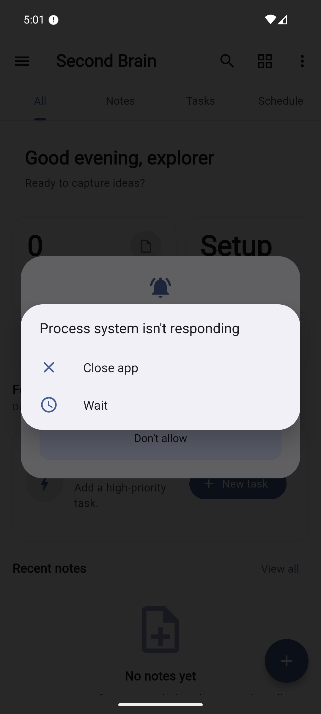](evidence/screenshots/01-startup.png) [01-startup.png](evidence/screenshots/01-startup.png) | Android system ANR dialog over the app. Retained as startup blocker evidence, not a healthy app state. |
| [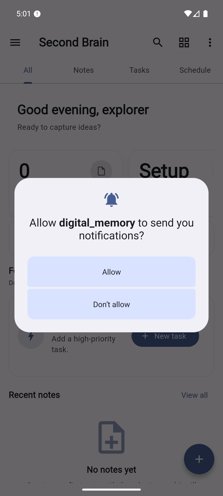](evidence/screenshots/02-permission.png) [02-permission.png](evidence/screenshots/02-permission.png) | First-run notification prompt before reminder creation. |
| [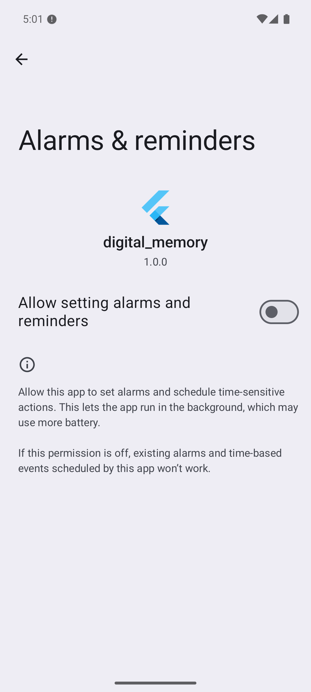](evidence/screenshots/03-alarm-permission.png) [03-alarm-permission.png](evidence/screenshots/03-alarm-permission.png) | Android alarms/reminders access screen, initially off; enabled to continue review. |
| [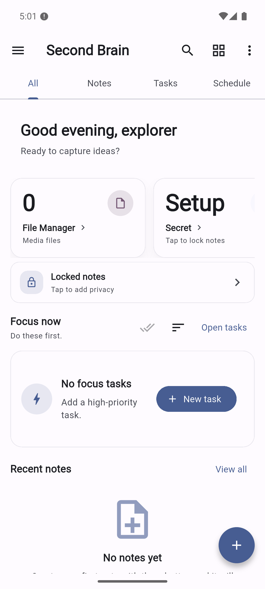](evidence/screenshots/04-home.png) [04-home.png](evidence/screenshots/04-home.png) | Stable All dashboard with empty fixture data. |
| [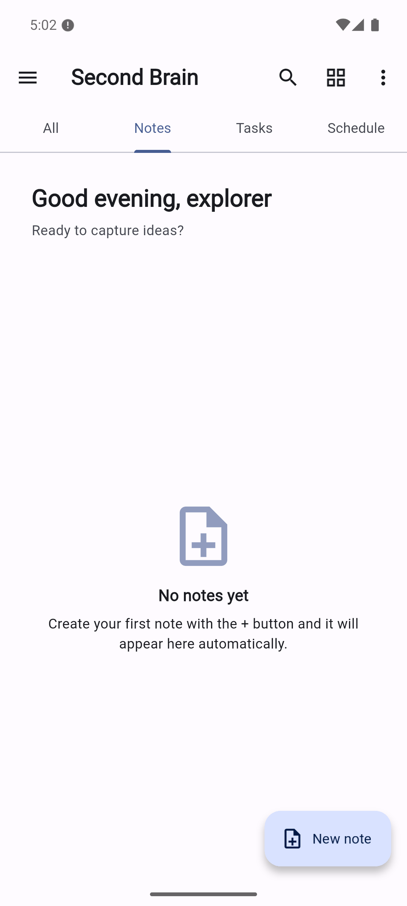](evidence/screenshots/05-notes-empty.png) [05-notes-empty.png](evidence/screenshots/05-notes-empty.png) | Notes empty state and New note action. |
| [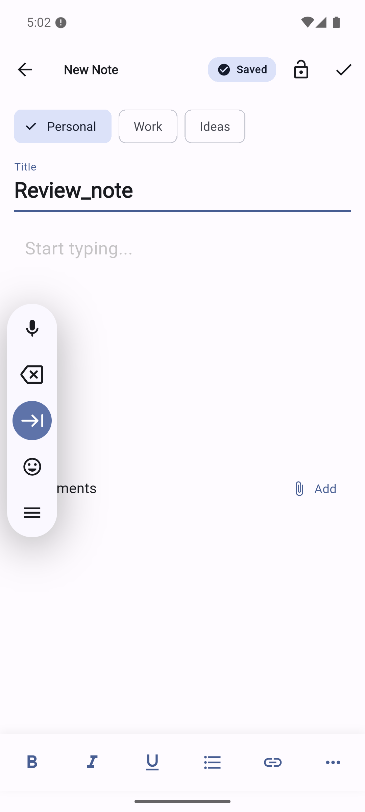](evidence/screenshots/06-note-editor.png) [06-note-editor.png](evidence/screenshots/06-note-editor.png) | Title entered; Saved indicator; body empty. Floating input toolbar belongs to Android IME. |
| [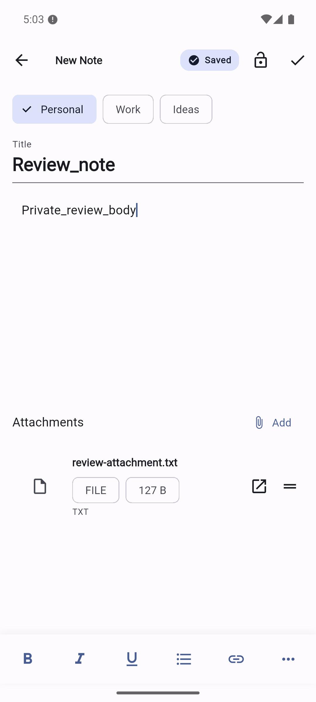](evidence/screenshots/07-note-with-attachment.png) [07-note-with-attachment.png](evidence/screenshots/07-note-with-attachment.png) | Synthetic note body and text attachment present in editor. |
| [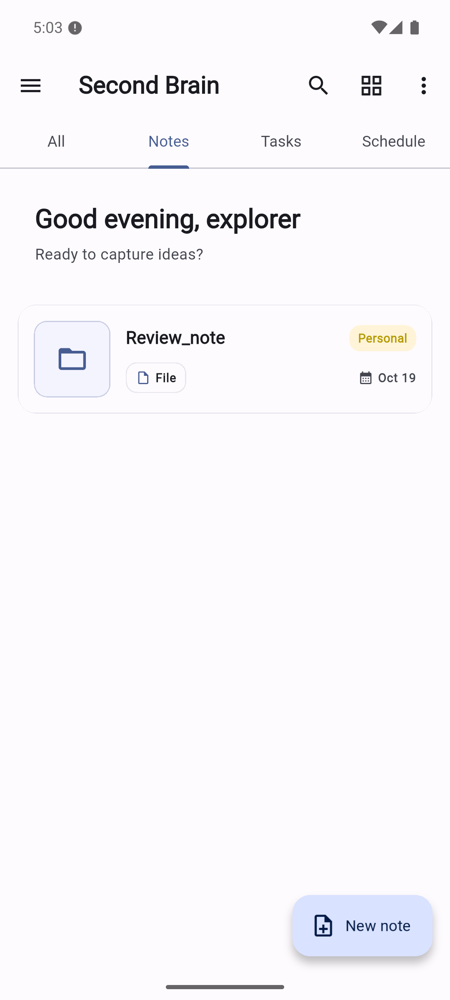](evidence/screenshots/08-notes-saved.png) [08-notes-saved.png](evidence/screenshots/08-notes-saved.png) | Saved note visible in Notes collection. |
|  [09-note-preview.png](evidence/screenshots/09-note-preview.png) | Read-only body and attachment preview. |
| [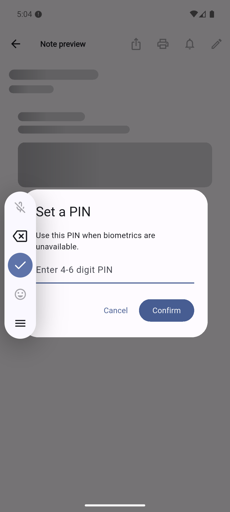](evidence/screenshots/10-lock-authentication.png) [10-lock-authentication.png](evidence/screenshots/10-lock-authentication.png) | Normal locked-note path requests PIN setup. Canceled without setting a PIN. |
| [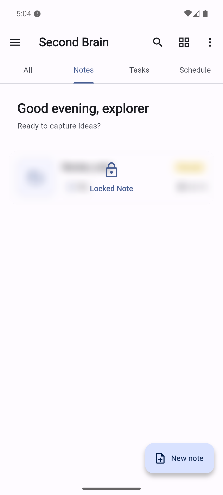](evidence/screenshots/11-locked-notes.png) [11-locked-notes.png](evidence/screenshots/11-locked-notes.png) | Visually blurred locked card after canceling authentication. |
| [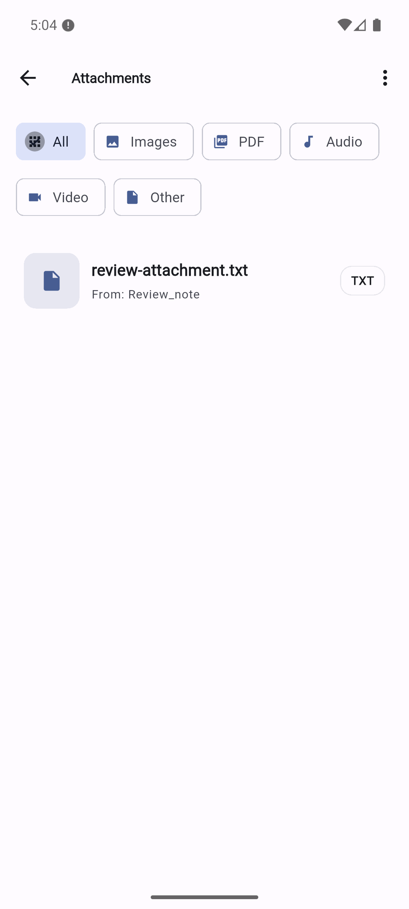](evidence/screenshots/12-private-attachment-visible.png) [12-private-attachment-visible.png](evidence/screenshots/12-private-attachment-visible.png) | File Manager reveals attachment and locked owner title without authorization. |
| [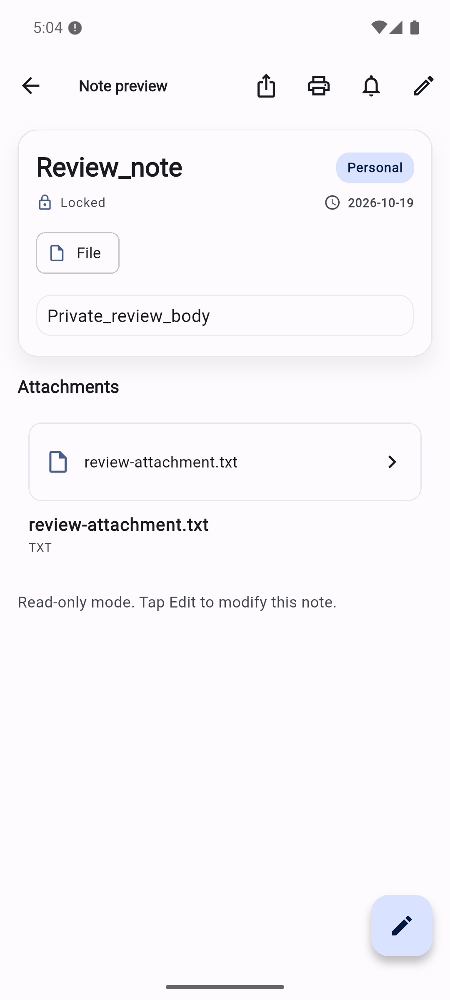](evidence/screenshots/13-lock-bypass-confirmed.png) [13-lock-bypass-confirmed.png](evidence/screenshots/13-lock-bypass-confirmed.png) | Locked note body visible through attachment path without authentication. F01. |
| [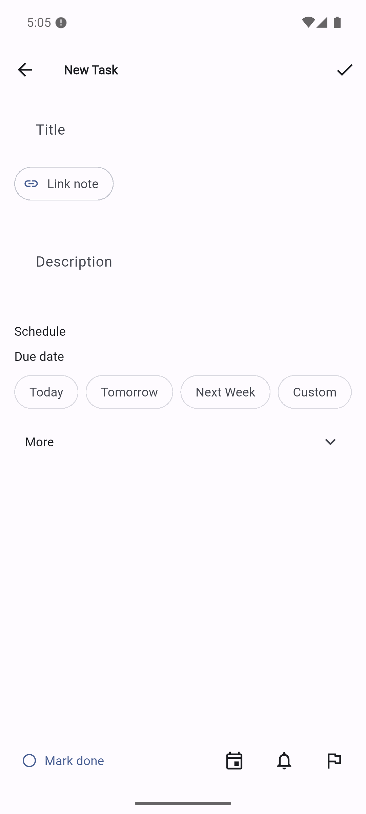](evidence/screenshots/14-task-editor.png) [14-task-editor.png](evidence/screenshots/14-task-editor.png) | Basic task form before data entry. |
| [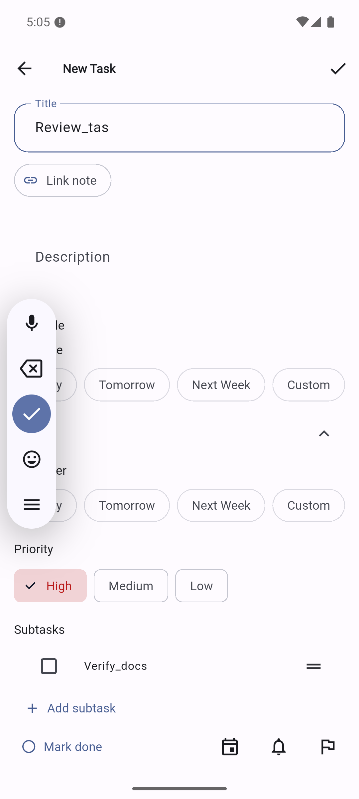](evidence/screenshots/15-task-details.png) [15-task-details.png](evidence/screenshots/15-task-details.png) | High priority and Verify_docs subtask in More. Saved title is Review_tas. |
| [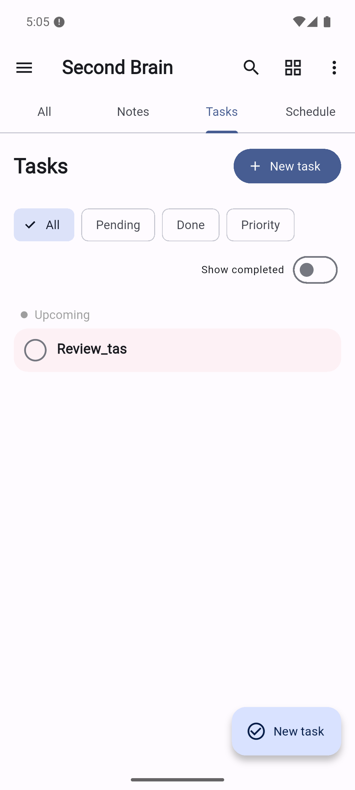](evidence/screenshots/16-tasks-saved.png) [16-tasks-saved.png](evidence/screenshots/16-tasks-saved.png) | Task saved in Tasks pane. |
|  [17-task-expanded.png](evidence/screenshots/17-task-expanded.png) | Expanded row reveals subtask. |
|  [18-task-collapsed.png](evidence/screenshots/18-task-collapsed.png) | Attempted subtask interaction collapsed the row; not proof of completion. |
| [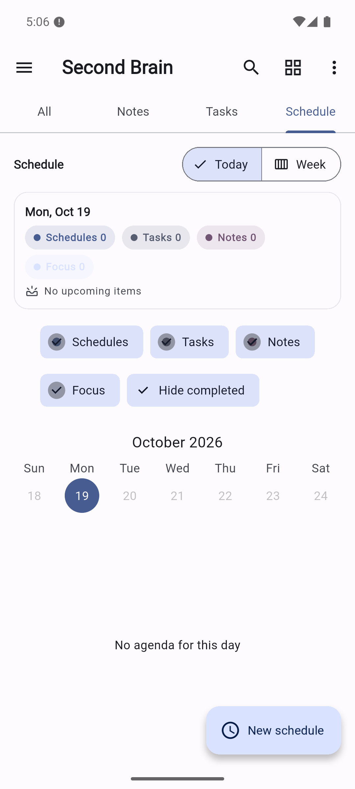](evidence/screenshots/19-schedule.png) [19-schedule.png](evidence/screenshots/19-schedule.png) | Empty schedule/day view. |
| [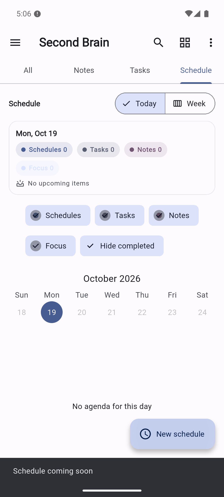](evidence/screenshots/20-schedule-placeholder.png) [20-schedule-placeholder.png](evidence/screenshots/20-schedule-placeholder.png) | New schedule action reports Schedule coming soon. F11. |
| [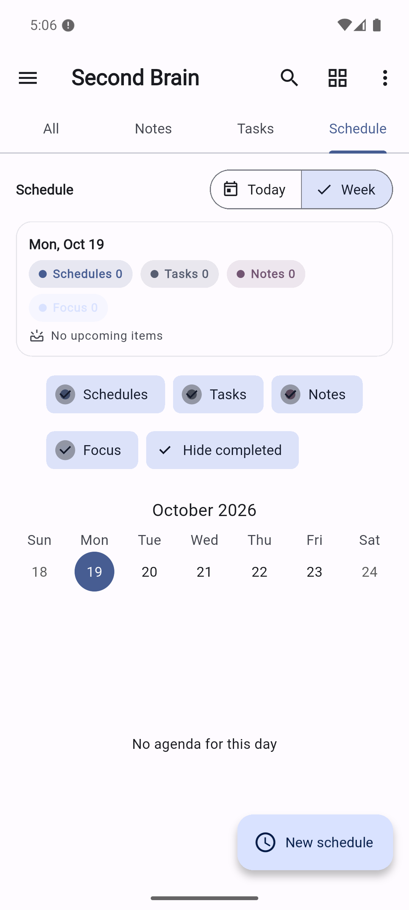](evidence/screenshots/21-schedule-week.png) [21-schedule-week.png](evidence/screenshots/21-schedule-week.png) | Week selection still has no agenda items. |
| [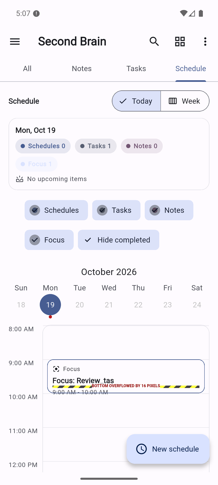](evidence/screenshots/22-schedule-with-task.png) [22-schedule-with-task.png](evidence/screenshots/22-schedule-with-task.png) | Dated task creates timeline/focus context; 16-pixel bottom overflow is visible. F18. |
| [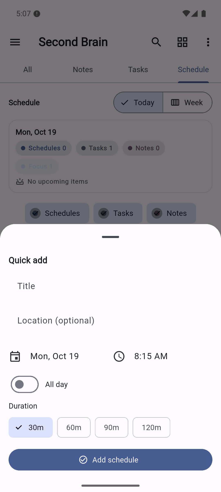](evidence/screenshots/23-schedule-quick-add.png) [23-schedule-quick-add.png](evidence/screenshots/23-schedule-quick-add.png) | Long press on empty timeline slot opens quick-add. |
| [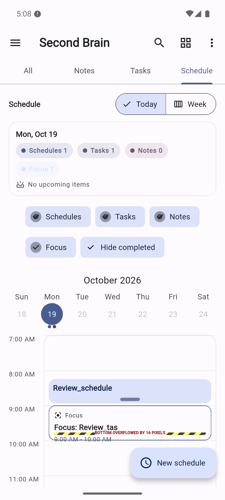](evidence/screenshots/24-schedule-created.png) [24-schedule-created.png](evidence/screenshots/24-schedule-created.png) | Review_schedule persisted and displayed; focus card still overflows. |
| [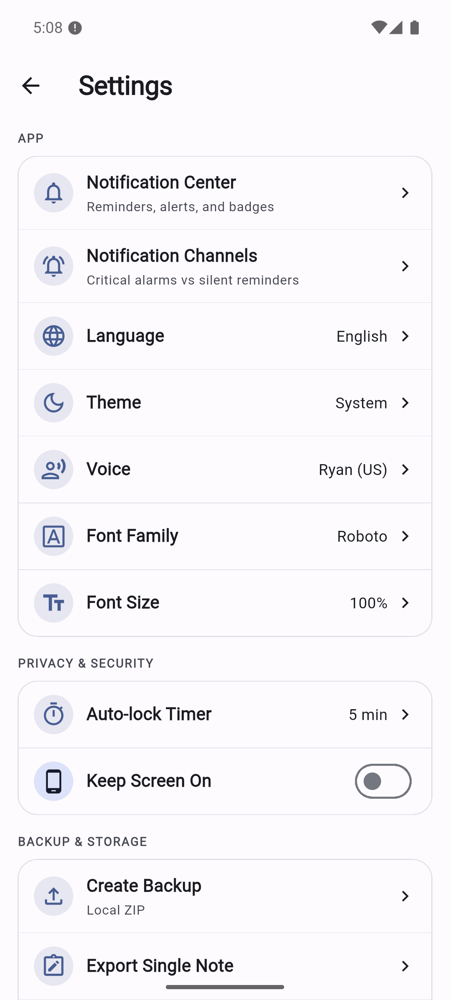](evidence/screenshots/25-settings.png) [25-settings.png](evidence/screenshots/25-settings.png) | Light settings groups and controls. |
| [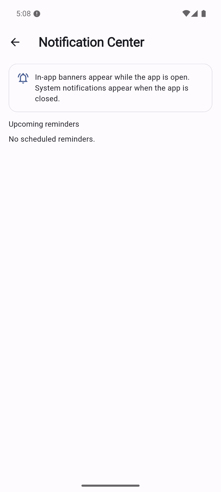](evidence/screenshots/26-notification-center.png) [26-notification-center.png](evidence/screenshots/26-notification-center.png) | No scheduled reminders. This is not a notification-delivery test. |
| [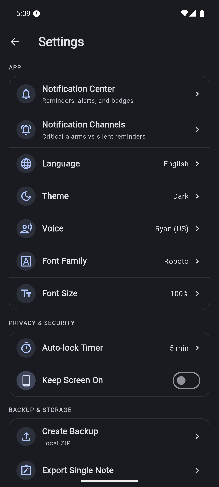](evidence/screenshots/27-settings-dark.png) [27-settings-dark.png](evidence/screenshots/27-settings-dark.png) | Theme changed to Dark and reflected immediately. |
| [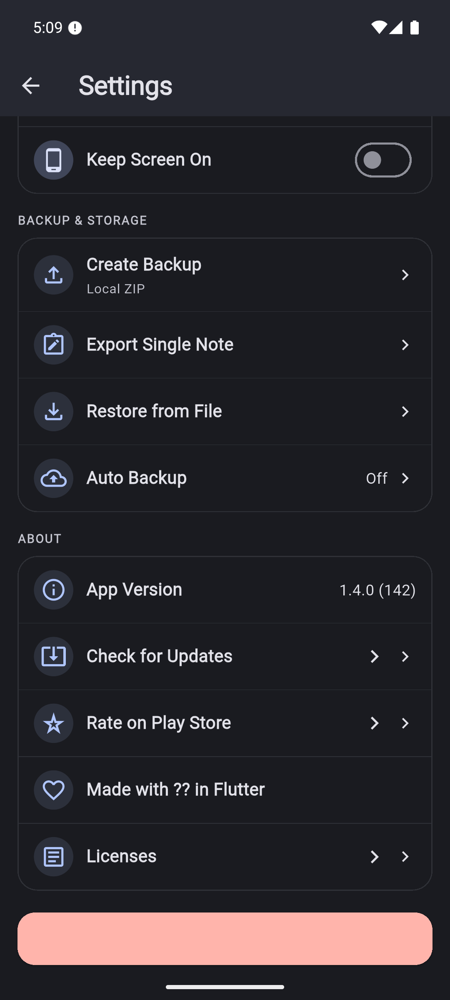](evidence/screenshots/28-backup-and-version.png) [28-backup-and-version.png](evidence/screenshots/28-backup-and-version.png) | Backup options, hardcoded incorrect version, malformed About copy and dark logout visibility risk. |
| [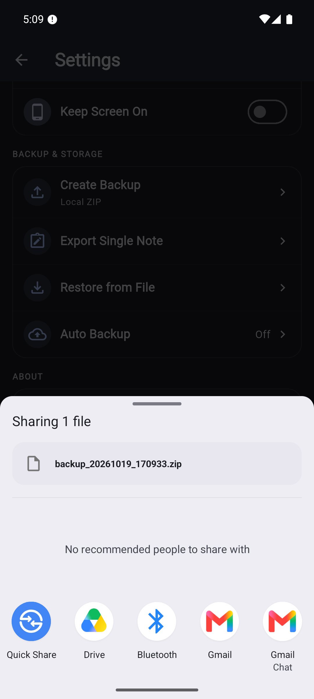](evidence/screenshots/29-backup-share.png) [29-backup-share.png](evidence/screenshots/29-backup-share.png) | Actual generated ZIP in Android share sheet; canceled, no external recipient selected. |
| [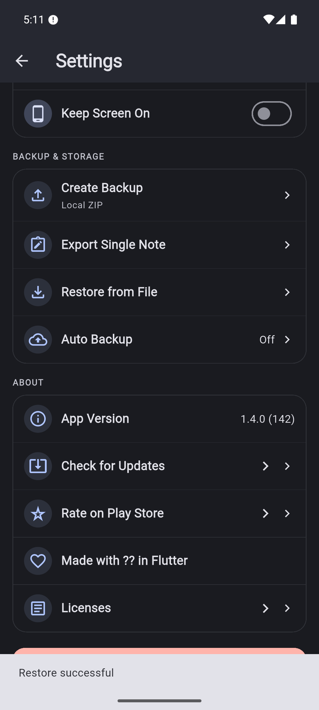](evidence/screenshots/30-restore-success-message.png) [30-restore-success-message.png](evidence/screenshots/30-restore-success-message.png) | Valid missing-ID import reports Restore successful. |
| [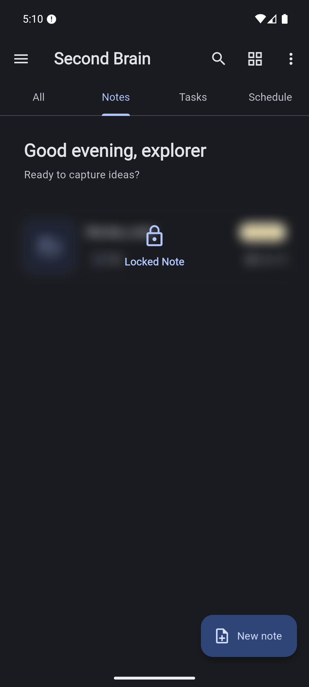](evidence/screenshots/31-restore-note-missing.png) [31-restore-note-missing.png](evidence/screenshots/31-restore-note-missing.png) | Only original note remains; Restore_probe absent. Database check corroborates F02. |
| [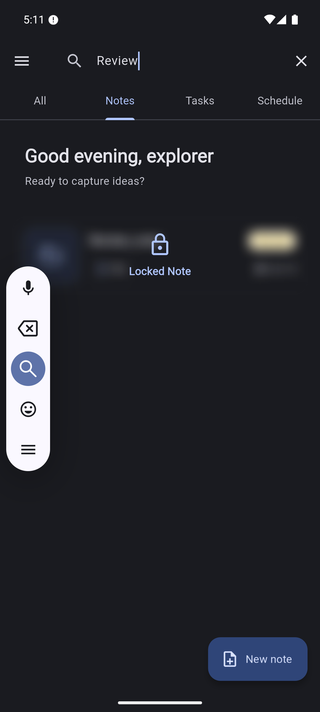](evidence/screenshots/32-search-locked-note.png) [32-search-locked-note.png](evidence/screenshots/32-search-locked-note.png) | Home inline search query before submission; locked card remains visually redacted. |
| [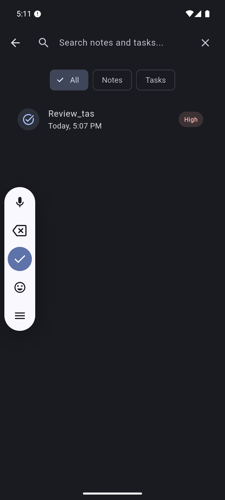](evidence/screenshots/33-global-search.png) [33-global-search.png](evidence/screenshots/33-global-search.png) | Task result for submitted Review query; destination field shows placeholder. F14. |
| [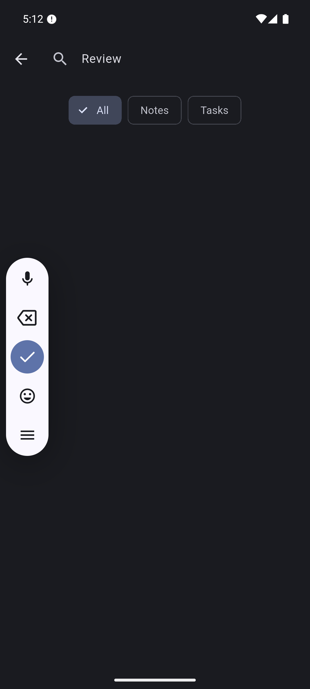](evidence/screenshots/34-search-clear-mismatch.png) [34-search-clear-mismatch.png](evidence/screenshots/34-search-clear-mismatch.png) | Clear removes results/state but leaves Review visible in input. F14. |
| [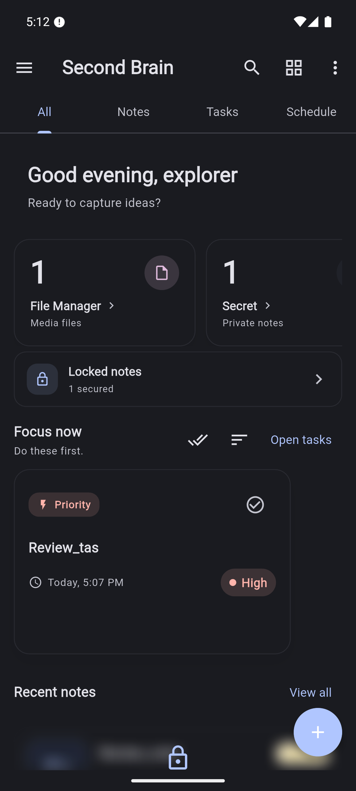](evidence/screenshots/35-cold-start-persistence.png) [35-cold-start-persistence.png](evidence/screenshots/35-cold-start-persistence.png) | Stable dashboard after force-stop and relaunch; dark theme and fixture data persist. |

## 3. Nonvisual proof

| Evidence | What it establishes |
|---|---|
| [Baseline Dart inventory](evidence/dart-file-inventory.json) | All 65 Dart file paths, nonblank lines, bytes, SHA-256 |
| [Final Dart hashes](evidence/dart-file-final-hashes.json) | Application/test Dart files unchanged during review |
| [Final analyzer](evidence/logs/flutter-analyze-final.txt) | 29 diagnostics: 6 warnings and 23 info |
| [Initial widget test](evidence/logs/flutter-test.txt) | Original Quill compiler incompatibility |
| [Test after compatibility](evidence/logs/flutter-test-after-compatibility.txt) | Existing test bootstrap failure |
| [Final Flutter run](evidence/logs/flutter-run-final.txt) | Fresh APK build/install, VM service, runtime layout assertion and intentional disconnect on force-stop |
| [Android Flutter log](evidence/logs/android-flutter-runtime.txt) | Plugin/runtime messages; layout assertion itself is in Flutter run log |
| [ZIP inspection](evidence/logs/backup-inspection.json) | Actual backup has one note JSON and no attachment file |
| [Restore probe](evidence/fixtures/restore-probe.zip) | Controlled valid notes-array import with ID 999999 |
| [Restore database result](evidence/logs/restore-probe-result.json) | Probe ID absent after successful toast |
| [Cold-start counts](evidence/logs/cold-start-persistence.json) | Note, attachment row, task, subtask and schedule survived process restart |
| [Doctor](evidence/logs/flutter-doctor.txt) | Toolchain and SDK-license caveat |
| [Documentation validation](evidence/logs/documentation-validation.json) | Current Markdown links, screenshot hashes, unchanged Dart sources, root layout |

UI hierarchy XMLs in evidence/logs/ supplement action targeting and visible labels. They are not substitutes for screenshots or actual TalkBack testing. Intermediate build failures are explained in [Verification](VERIFICATION.md). No raw app database is published as an evidence artifact; database checks retained only synthetic record/count summaries.

## 4. Diagram provenance

The [editable tldraw board](https://www.tldraw.com/f/MJ8ymcLzU-nKT2TWyaEVd) contains architecture and workflow diagrams built as editable shapes. The board was screenshotted, exported locally, and the saved PNG inspected. Sources are [architecture.mmd](diagrams/architecture.mmd) and [workflow.mmd](diagrams/workflow.mmd).

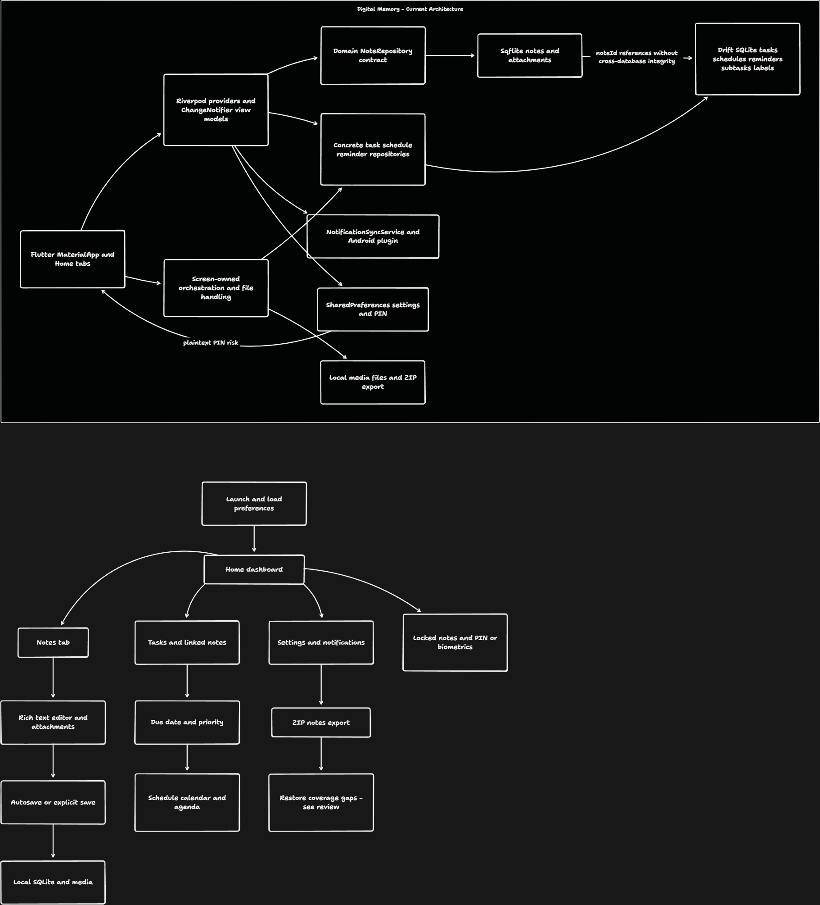

## 5. Interpretation limits

Screenshots show visible states, not complete correctness. The ZIP/database observations establish only the stated fixture behavior. This set does not establish encryption, full accessibility, physical-device performance, all supported media, notification delivery after reboot, all migrations, or other operating-system support. See [Workflow](APP_WORKFLOW.md) for step-specific strengths, risks, and recommendations.
