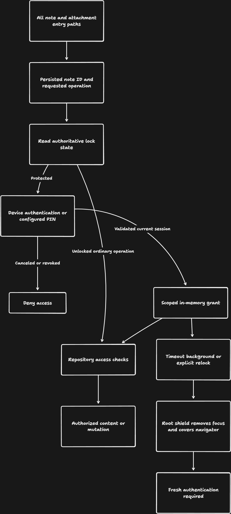
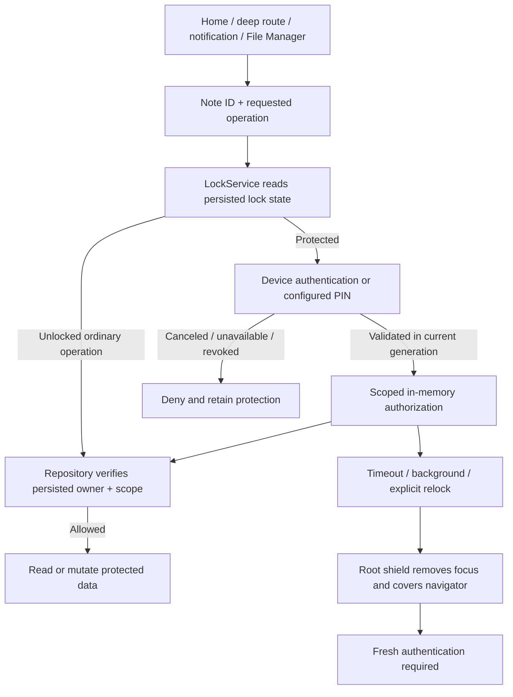

# Noteable / Digital Memory — Phase A privacy repair

**Date:** 19 October 2026 · **Scope:** privacy and authentication only · **Baseline:** `d9c56f80ce354af4f5157e4aca23b28e7cbba177`

> **P0 release gate: FAIL.** Phase B recovery defects remain unresolved by instruction. Privacy changes are a release candidate, subject to the verification results and limitations below. This report supersedes the privacy implementation descriptions in the original audit, not its historical evidence.

## 1. Critical verification incident

During Android verification, `flutter run` encountered `INSTALL_FAILED_INSUFFICIENT_STORAGE` on the original `emulator-5554`. Flutter's install recovery automatically uninstalled the existing application before retrying. That uninstall removed its application data. This was unintended, was disclosed to the user, and means this execution **did not satisfy the data-preservation requirement on that emulator**. The original application database has not been recovered. Earlier audit counts and screenshots are historical evidence, not a current recoverable database snapshot.

No database reset or destructive migration was added to the application. This does not excuse the tooling incident. The original emulator was left alone after read-only investigation. Subsequent native verification uses a newly created, disposable AVD, `Noteable_Privacy_API35_20261019`, on port 5560, with synthetic records only. Its data partition has sufficient installation space. Future updates to data-bearing installations must use a verified backup and explicit update-only installation; stop on installation failure, rather than allowing automatic uninstall/reinstall recovery.

## 2. Source-confirmed root causes

| Defect | Root cause | Affected implementation |
|---|---|---|
| Alternative routes bypassed note locks | UI flags and vault state substituted for authorization; `skipLockCheck` trusted callers | Home, locked vault, preview, File Manager, notifications and reminder navigation |
| Repository returned protected data | Reads, search, mutations and attachment enumeration did not enforce the persisted owner's lock state | Domain/data note repositories; attachment/home view models |
| Locked metadata leaked | Titles, body snippets, attachment names/paths and reminders were available before authentication | Note lists, File Manager, linked-note labels, notification scheduling |
| Weak credential storage and setup | PIN persisted in ordinary preferences; canceled/incomplete setup could be treated as sufficient protection | Lock service and lock toggle callers |
| Inconsistent session lifecycle | Screen-specific timers and biometric availability checks left alternate routes and cached content uncovered | Home, settings, vault and navigator lifecycle |
| Authentication lifecycle hazards | An outstanding prompt could outlive revocation; hidden widgets could retain keyboard focus | Central session policy, prompt route and root privacy host |

## 3. Implemented controls and decisions

### Authorization boundary

One injected `NoteAuthorization` instance owns in-memory, note-ID-and-operation-scoped grants. The repository consults the **persisted** lock flag before returning full note content or modifying protected records. Grant operations are `read`, `edit`, `attachment`, `changeLock`, `delete`, `share` and `export`. Attachment-only authorization does not grant access to its owner's note body. No `skipLockCheck` references remain in application code.

Locked list/summary results retain only an opaque ID, the locked flag and a generic placeholder; title, category, body, rich text, pin state and timestamps are redacted. Search excludes locked notes. Attachment enumeration joins the owning note and filters unauthorized and orphaned entries. Queries recheck authorization after asynchronous work; transactional writes recheck before commit, so revocation rolls back the affected mutation.

[Editable tldraw review board](https://www.tldraw.com/f/MJ8ymcLzU-nKT2TWyaEVd), with the Phase A flow below the preserved audit diagrams. The export below explains the implementation; it is not evidence of test execution.

Destination screens authenticate before hydration. Notification/reminder/task links obtain a redacted summary and use the same destination checks. Share and export require their own operation grant, including a final authorization check before external handoff. A vault read grant does not authorize sharing, deletion or export.

### PIN protection and migration

- New PINs require exactly six digits and matching confirmation. Setup never replaces an existing credential. Canceled setup grants no session; a new draft may leave an empty shell row, without saving its private body or attachments.
- PBKDF2-HMAC-SHA256 uses 600,000 iterations, a cryptographically random 16-byte salt and a 256-bit verifier, through established `cryptography` / `cryptography_flutter` implementations. Derivation runs off the UI isolate. Comparisons use the library's constant-time byte equality.
- Verifier and failed-attempt state live in platform secure storage. PINs are not logged or written to ordinary preferences. Five failed attempts trigger 30 seconds of blocking, increasing up to one hour; state survives service recreation. Requests are serialized to avoid resetting counters through concurrent attempts.
- Legacy nonempty PINs of up to six characters are preserved for authentication, including previously accepted short values. Migration writes and reads back the secure verifier **before** removing plaintext. Unsupported/corrupt credentials or failed storage operations deny access and retain recoverable source credentials.
- Apple storage explicitly requests device-only accessibility. Migration from the earlier secure-storage policy uses a separate v2 key, verifies the replacement, then removes the old key using its original policy. Interrupted cleanup is retried even when v2 already exists; v2's current throttling state remains authoritative.
- Android backup/transfer rules exclude secure-storage preference files, key storage and the legacy shared-preferences file. Excluding the entire preferences file is necessary while a legacy plaintext PIN may still exist; portable preference recovery belongs to Phase B.

### Session and platform behavior

A monotonic foreground session timeout revokes capabilities. The existing timeout preference is honored; “Off” disables foreground expiry but **does not** disable background relocking. Inactive transitions cover the entire navigator and remove keyboard focus; background transitions revoke pending authentication and grants. On resume, cached private content stays covered until fresh proof is accepted. Explicit vault relocking uses the same policy. Generation-owned authentication attempts prevent late callbacks from granting access or blocking a new attempt. Revocation also dismisses stale PIN prompts.

Biometric unavailability never switches protection off. Supported device authentication may use the OS screen-lock credential, with an existing application PIN as fallback. Existing protected data without a usable credential remains inaccessible; enrollment of a new PIN is not an unauthenticated recovery mechanism.

Android `FLAG_SECURE` protects the app window, including transitions and recents snapshots. This intentionally prevents screenshots/casting throughout the app. Platform guarantees and physical-device behavior require the manual checks below.

### Boundary with Phase B

Protected bulk portable backup is blocked with an explanatory message, and the single-note portable export picker excludes locked records until an authorized, encrypted backup format exists. **No backup/restore service or restore algorithm was modified.** The known missing-ID restore defect, incomplete snapshot format, misleading restore feedback and cross-database recovery design remain Phase B work. No encryption-at-rest or complete-backup claim is made.

## 4. Exact changed files

The complete inventory, including test and evidence files, is recorded in [changed-files.txt](evidence/phase-a-2026-10-19/changed-files.txt). The application changes are grouped below.

| Area | Files |
|---|---|
| Central policy and credentials | `lib/core/services/note_authorization.dart` (new), `pin_store.dart` (new), `lock_service.dart`, `auth_service.dart` |
| Repository enforcement | `lib/domain/repositories/note_repository.dart`, `lib/data/repositories/note_repository.dart` |
| Dependency injection and caches | `lib/presentation/view_models/di.dart`, `home_vm.dart`, `attachments_vm.dart` |
| Root lifecycle shield | `lib/app/app.dart`, `lib/presentation/widgets/privacy_host.dart` (new) |
| Note/vault/file entry paths | Home screen, locked-notes page, locked-vault widget, note editor, note preview, attachments screen |
| Notifications and links | `notification_sync_service.dart`, notification-center screen, in-app-reminder host, task-editor screen, schedule tab |
| Protection preferences and export guard | Settings screen |
| Native protection | Android manifest, `MainActivity.kt`, credential backup/extraction XML rules (new), macOS generated plugin registration |
| Dependencies | `pubspec.yaml`, `pubspec.lock` |
| Permanent regressions | Authorization, PIN/migration, repository, privacy-host, real-route and Home tests; isolated fixture; Android integration suite |
| CI | `.github/workflows/flutter-privacy.yml` (new) |
| Documentation | This report, README/index links and dated evidence |

## 5. Verification results

Final command results are recorded below when execution completes. Earlier failed attempts are retained separately; a focused pass does not erase an earlier failure.

| Check | Result | Evidence |
|---|---|---|
| `flutter analyze` | Exit 1: 0 errors, 4 existing warnings, 24 informational lints | [Analyzer log](evidence/phase-a-2026-10-19/analyze-final.txt) |
| `flutter test --concurrency=1 --reporter expanded` | PASS: 30 tests, 2 minutes 22 seconds | [Full test log](evidence/phase-a-2026-10-19/flutter-test-final.txt) |
| Prompt revocation → root PIN reauthentication | PASS, 1 test | [Focused regression](evidence/phase-a-2026-10-19/prompt-revocation-final.txt) |
| Interrupted verifier migration | PASS, focused regression; included in full suite | `test/lock_service_test.dart` |
| `flutter test integration_test/phase_a_privacy_test.dart -d emulator-5560 --no-pub --reporter expanded` | PASS: 8 tests; test execution 1 minute 35 seconds after build/install | [Final run](evidence/phase-a-2026-10-19/android-integration-final.txt), [earlier failed attempt](evidence/phase-a-2026-10-19/android-integration.txt) |
| `flutter build apk --debug --no-pub` | PASS: final normal-app build, 116.5 seconds | [Final application build](evidence/phase-a-2026-10-19/android-app-build-final.txt) |
| Physical Android / iOS/macOS execution | NOT RUN | Manual checklist below |
| Independent final source review | No remaining Critical/Important findings; native behavior not assessed | Focus exclusion, prompt lifecycle and interrupted migration re-reviewed |
| Hosted CI | Workflow added; remote execution not yet verified | `.github/workflows/flutter-privacy.yml` |

The baseline Home test failed due to missing provider bootstrap and an outdated label assertion. Its replacement uses injected preferences, real temporary SQLite/Drift databases and the actual Home screen. Test fixtures own their temporary directories and do not clear/reset production databases. Regression tests cover failure/cancellation, ID/operation scope, attachment/body separation, metadata redaction, unauthorized mutation preservation, migration/throttling, timeout/background revocation, keyboard/clipboard exclusion, direct preview/editor cancellation, File Manager and normal unlocked preview/Home behavior.

The Android suite separately exercises native secure-storage migration and device-authentication denial on an AVD without enrolled credentials, then runs real Sqflite route tests. Route tests deliberately substitute the authentication boundary; they do not prove biometric hardware behavior. Earlier failures included a PIN-test timeout under resource contention, an integration VM-service disconnect and the root-overlay regression. Their subsequent status must be read from the final logs.

### Android capture evidence

The isolated API 35 AVD reported `SECURE` on `MainActivity` in [window flags](evidence/phase-a-2026-10-19/android-window-flags.txt). The unmodified OS capture below is black. This is evidence of capture protection for this emulator run, not a visible proof of all authorization paths. Those paths are exercised by the test assertions and logs. Privacy protection was not disabled to obtain a more decorative screenshot.

## 6. Remaining risks and limitations

| Risk / limitation | Consequence / next action |
|---|---|
| Original-emulator application data was removed by install recovery | Preservation requirement failed; original database remains unrecovered. Do not treat source control or audit screenshots as application-data backups. |
| SQLite and attachment files remain plaintext | The authorization boundary protects application entry paths; it does not provide encryption against filesystem/root/device extraction. |
| Phase B remains unresolved | Full recoverability, collision-safe restore, archive integrity and encrypted protected backups are release blockers. |
| Native platform and physical-device matrix incomplete | Check screen capture, actual device credentials, biometrics, process death and OS backup/transfer before release. Apple behavior is source-reviewed only. |
| Previously scheduled OS notifications | New scheduling is generic. Already-delivered historical notification content outside the app cannot be recalled reliably; verify upgrade behavior. |
| External sharing and attachment viewers | Explicit authorization hands data to another app. Copies already handed off cannot be revoked by a later vault relock. Temporary share files are not encrypted/automatically expired by this phase. |
| Preexisting editing/Undo behavior | Lock-mode editor behavior and deleted-note recovery are not redesigned here. Undo/recovery needs Phase B regression coverage. |
| Six-digit PIN entropy | Device secure storage and persistent throttling reduce guessing risk; rooted/device-compromised offline attacks are outside this claim. No unauthenticated PIN-reset path was introduced. |
| CI enforcement | A workflow file does not itself configure required branch-protection checks. Verify a successful hosted run and make the privacy job required before release. |

## 7. Manual Android release checklist

Run on a disposable emulator first, then a physical device, using a verified recoverable copy of test data. Record device/API/build, steps and actual results for every row. Unchecked rows are **NOT VERIFIED**.

- [ ] Capture a verified baseline database/media snapshot and counts; ensure adequate storage; update with `adb install -r`. Stop on failure. Never uninstall a data-bearing installation to make an update succeed.
- [ ] Unlock a private note from Home and vault; cancel/wrong PIN must deny access. Verify titles, body, rich text and attachment names/paths are hidden beforehand.
- [ ] Try direct preview and editor routes, File Manager, search, notification center, scheduled OS notification, in-app reminder and task/schedule links. All private destinations must authenticate.
- [ ] Request an attachment-only grant and verify it cannot obtain the owner body. Verify image/video/audio/PDF/file routes before and after relocking.
- [ ] Confirm read authorization does not silently authorize edit, share, export, delete or changing lock state. Cancel each additional operation's authentication.
- [ ] Begin PIN setup on a new private draft; cancel the first/confirmation dialog, enter a mismatch, background during setup, and expire an existing session. No private content should become accessible through a new session or an unlocked saved draft.
- [ ] Enter five wrong PINs, restart the process, and confirm a correct PIN is still blocked until the recorded delay expires. Verify concurrent requests cannot reset the counter.
- [ ] Upgrade a legacy PIN installation; verify old PIN still works, plaintext is removed only after verified secure persistence, and an interrupted migration retries cleanup without resetting throttling.
- [ ] Disable/enroll device credentials and biometrics in turn. Verify configured PIN fallback, cancel behavior and persistent privacy settings; no-credential cases must fail closed.
- [ ] Expire while preview/editor/media/share authentication is open. Cached content, semantics, keyboard focus and clipboard shortcuts must be inaccessible; fresh root authentication must work.
- [ ] Background/resume, open recents, capture a screenshot/screen recording, rotate and kill/relaunch. Confirm shield/`FLAG_SECURE` behavior and session invalidation. “Off” foreground timeout must still relock on background.
- [ ] Verify ordinary unlocked note creation/editing/search/attachments/sharing/deletion still work. Compare database and media counts after the update, not just the visible screen.
- [ ] Confirm protected bulk portable export is blocked and no full-backup/restore claim is accepted as verified. Do not test restore on the only copy of data.

## 8. Release verdict and stop point

**Overall P0 release gate: FAIL.** Recovery remains a separate unresolved P0 and the original-emulator preservation incident is a failed requirement. **Phase A automated host and Android emulator checks: PASS. Physical-device and Apple-platform acceptance: NOT VERIFIED.** The full manual entry-path and device matrix above is still required before a privacy release; passing automated checks does not establish every platform behavior.

Phase B has not started. Approval is required before changing backup/recovery implementation.

## References

- [OWASP password storage guidance](https://cheatsheetseries.owasp.org/cheatsheets/Password_Storage_Cheat_Sheet.html): PBKDF2-HMAC-SHA256 iteration guidance.
- [cryptography PBKDF2 API](https://pub.dev/documentation/cryptography/latest/cryptography/Pbkdf2-class.html) and [flutter_secure_storage 9.2.4](https://pub.dev/packages/flutter_secure_storage/versions/9.2.4): established derivation and secure-storage implementations.
- [Android secure activities](https://developer.android.com/security/fraud-prevention/activities) and [Auto Backup](https://developer.android.com/identity/data/autobackup): platform capture/backup policy boundaries.
